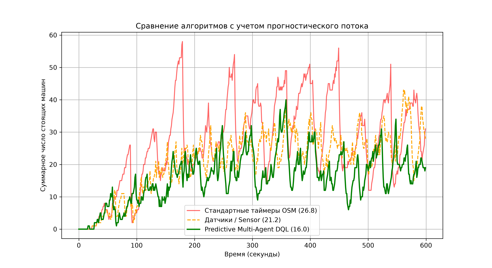

# Multi-Agent Deep Q-Learning for Adaptive Traffic Signal Control in Tashkent


An end-to-end Multi-Agent Reinforcement Learning (MARL) framework designed to optimize traffic light control and reduce urban congestion across a real-world 11-intersection corridor in Tashkent, Uzbekistan (Amir Temur Avenue region).

---

## Abstract

This article discusses the growing problem of traffic congestion in Tashkent, its environmental and economic consequences, and the limitations of traditional approaches to addressing this issue. It examines measures taken to tackle the problem, including government policy amendments, the "Uzbekistan-2030" national strategy, and the installation of 4,000 smart traffic lights. The study also reviews international experience in integrating artificial intelligence (AI) into intelligent transport systems (ITS). 

As a potential solution, a multi-agent traffic control system based on a deep Q-learning algorithm is proposed. Simulations were conducted using the SUMO (Simulation of Urban MObility) platform, modelling an 11-intersection corridor along Amir Temur Avenue during peak hours (800–1,000 vehicles per hour per direction). The simulation results indicate that the proposed "Predictive MADQL" algorithm reduced the average queue length to 16.0 vehicles — an improvement in efficiency of 40.3% compared to static-timer traffic lights (26.8 vehicles) and 24.5% compared to traditional sensor-based traffic lights (21.2 vehicles). The paper concludes with practical recommendations for the Tashkent Traffic Management Centre regarding the integration of artificial intelligence into intelligent transport systems.

**Keywords:** Artificial Intelligence, Intelligent Transportation Systems, Traffic Congestion, Tashkent, SUMO, Deep Q-Learning, Multi-Agent Systems, Predictive MADQL, Traffic Signal Control.

---

## Key Features

- **Real-World Topography:** Map data extracted directly from OpenStreetMap (OSM) and compiled into a realistic 11-junction road network using SUMO's `netconvert`.
- **Predictive State Space:** Incorporates a 4-dimensional state feature vector per agent:
  $$\text{State} = [\text{green\_queue}, \text{red\_queue}, \text{current\_phase}, \text{approaching\_vehicles}]$$
  This lookahead capability prevents bottlenecks before vehicles come to a complete halt.
- **Shared-Parameter Multi-Agent Architecture:** A unified Deep Q-Network controls all 11 traffic intersections simultaneously, encouraging cooperative flow coordination across adjacent junctions.
- **Rush-Hour Stress Testing:** Evaluated under dynamic traffic conditions featuring a mid-simulation surge in side-street vehicle density.

---

## Performance & Benchmark

Under simulated peak traffic conditions (600-second rush-hour scenario), the **Predictive MADQL** system demonstrated significant superiority over both static timer baselines and greedy sensor-based heuristics.

| Control Strategy | Avg. Halting Queue (Vehicles) | Improvement vs. Static | Improvement vs. Sensors |
| :--- | :---: | :---: | :---: |
| **Static OSM Timers** | 26.8 | — | — |
| **Greedy Sensor Control** | 21.2 | +20.9% | — |
| **Predictive MADQL (Ours)** | **16.0** | **+40.3%** | **+24.5%** |



---

## Repository Structure

```text
├── dql_agent.py               # Core DQN architecture, replay buffer, and Epsilon-Greedy logic
├── train_tashkent_madql.py    # Multi-agent training loop with TraCI simulation interface
├── compare_tashkent.py        # Benchmark script comparing Static, Sensor, and DQL agents
├── visualize_tashkent.py      # Interactive GUI visualizer for trained model execution
├── get_tashkent_map.py        # OpenStreetMap fetcher and SUMO network converter
├── build_rush_hour.py         # Dynamic rush-hour traffic route generator
├── check_tls.py               # Traffic Light Signal (TLS) node inspector
├── tashkent.net.xml           # Compiled SUMO road network of Tashkent corridor
├── tashkent_rush.sumocfg      # Main SUMO simulation configuration file
├── tashkent_madql_model.pth   # Saved PyTorch neural network weights
└── tashkent_madql_comparison.png # High-resolution benchmark chart